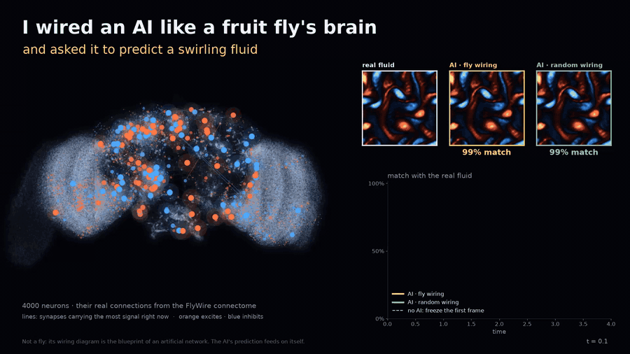
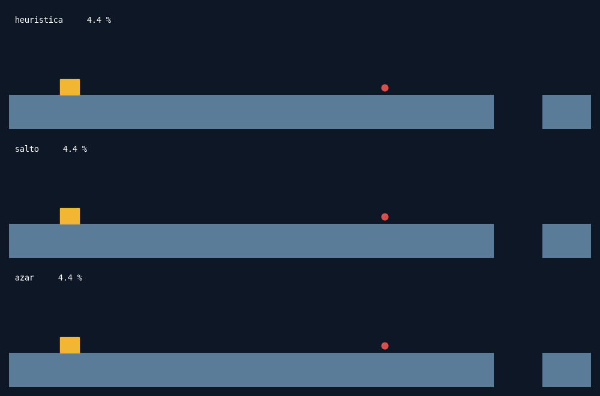
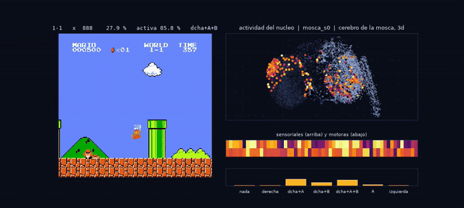

# Mosca — an AI wired like a fruit fly's brain, predicting a fluid

[Español](README.es.md)

<p align="center">
  
</p>

We take the wiring diagram of the *Drosophila* brain (FlyWire connectome, ~139,000 neurons),
cut out a piece, and build an artificial recurrent network that can **only use the
connections that exist in the fly**, keeping which neurons excite and which inhibit (Dale's
law). Then we train it to predict a 2D Navier–Stokes flow one step ahead.

**The question:** does the real wiring help, compared with random wiring that has the same
statistics?

> **Not a fly.** Nothing here is a fly or a model of how a fly thinks. The connectome is used
> as the blueprint of an artificial network.

## Pre-registered prediction

Written down before seeing any result ([design, §3](diseno_mosca_navier_stokes.md)):

| | Hypothesis |
|---|---|
| **H0** | The fly wiring performs the same as random wiring of the same density |
| **H1** | Any advantage is explained by the degree distribution (fly ≈ degree-preserving rewired) |
| **H2** | The specific structure matters (fly > rewired, significant) |

We expect **H0 or H1**, and a Fourier Neural Operator (FNO) to beat every wired network.
A null result is a valid result.

## The seven models

Only the connectivity mask changes between the wired models; encoder, decoder, training
recipe and parameter budget are shared.

| Model | Recurrent core |
|---|---|
| `mosca` | FlyWire subgraph, real signs |
| `aleatorio` | Erdős–Rényi, same density and inhibitory fraction |
| `recableado` | Fly graph with edges shuffled, **degrees preserved exactly** |
| `denso` | All-to-all, fewer neurons, same number of trainable weights |
| `sin_nucleo` | Same neurons, signs and ports as the fly, **zero connections** (control) |
| `fno` | Fourier Neural Operator (upper reference) |
| `persistencia` | Predicts "nothing changes" (lower reference) |

Pipeline: vorticity field → FFT → lowest Fourier modes → *sensory* neurons (highest
out-degree) → masked recurrent core (4 internal steps) → *motor* neurons (highest in-degree)
→ modes → inverse FFT → **increment** added to the field.

`sin_nucleo` is the control that says whether there is anything to discuss: if the fly does
not beat it, what it predicts does not come from its wiring but from the encoder and decoder
every model shares.

## The second task: Mario

The same wired core playing instead of predicting ([design, §13](diseno_mosca_navier_stokes.md)).
Two environments with **the same 302-number symbolic observation**, so the policy is
identical in both: a hand-written platformer with procedural levels, and the real NES Super
Mario Bros through an emulator, reading the tile map out of the RAM. The anatomical viewer
(`visor_nes.py`) puts the game on one side and, on the other, the 139,000 connectome neurons
with the subgraph lighting up on top, at their real FlyWire coordinates.

<p align="center">
  
</p>

And the fly-wired network playing NES Super Mario Bros, with its brain next to it (300 PPO
iterations, sampled policy). Honestly: this demo trains and measures on the same level, it
beats the constant-jump policy (p = 0.008) and is **indistinguishable from mashing buttons
at random** (p = 0.25).

<p align="center">
  
</p>

Every number is read against four reference policies (random, always right, constant jump,
hand-written heuristic) or it is not read at all: **PPO falls into the degenerate policy on
its own** — always jumping right already covers 38 % of the level. In the laptop rehearsal
the six models tie and none beats it.

**The Mario experiment is closed with no resolution.** The core *can* represent a good
policy: cloned from the heuristic it reaches 0.82-0.84 of the level, and PPO keeps it when
it starts from there. But from scratch PPO never finds it, **and neither does an
unconstrained MLP**. The bottleneck is exploration, not wiring, so a tie between six models
stuck in the same degenerate policy would say nothing about the connectome. The 36 GPU runs
of this task are not launched.

By imitation, the fly-wired network does clear NES level 1-1 (0.947 of the level, the flag
in 4 of 12 games): [video](docs/media/mosca_clonada_1-1.mp4). That is a demo, not science:
same level, copied from a hand-written teacher. And with controls, the wiring gets no
credit: random, rewired and dense cores clone it just as well (0.91-1.00 over three
seeds), and the two models with no recurrence mostly stall at the first pipe (0.32 on
average). What clears the level is memory, not the fly.

## Status

**Work in progress. No final result yet.** The real experiment (N = 4,000 neurons, 64×64
grid, 3 seeds per model) is running on a GPU, 8 of 18 runs done. The first seed already
changes the rehearsal's reading: at full scale the fly core **does** pull away from doing
nothing, 11 % better than persistence and 4 % better than the zero-connection control over
a 50-step rollout, where at rehearsal scale it lost. With a single seed that is promising,
not confirmed; fly against random and rewired needs all 18. See
[`RESULTADOS.md`](RESULTADOS.md) for every number, including the ones that went wrong.

<!-- RESULTS -->

## What we learned on the way

- **A bug in data augmentation**: the free translation was applied along the axis that
  carries the forcing `sin(4y)`, so augmented pairs had 4 % physically wrong content while the
  signal to learn is ~10 % of the field. Caught with a test against the simulator; every
  earlier result with augmentation was discarded.
- **Unfair ports**: letting input and output neurons overlap freely gave the fly 159
  input→output shortcuts and the random graph 18. Overlap is now fixed at 92 for every model.
- **The zero-connection control**: at rehearsal scale (N=500, 32×32, 20,000 steps) the fly
  beats `sin_nucleo` — the same neurons with no connections at all — by 0.0004 error. That
  is the number that says whether there is anything to discuss, and so far it says no: at
  this scale the model's prediction does not come from its recurrence.
- **The ceiling of the design**: even a perfect core would only lower the one-step error from
  0.105 to 0.083 at 64×64, because the encoder sees only the lowest Fourier modes. There is a
  window to tell wirings apart, but it is narrow.

## Run it

```bash
python -m venv .venv && source .venv/bin/activate
pip install -r requirements.txt           # on GPU, install the CUDA torch wheel
pytest -q

python -m data.download_flywire           # connectome, 105 MB
python -m data.download_annotations       # neuron positions for the viewer, 32 MB
python -m data.simulate_ns   --config configs/ns_32_proto.yaml
python -m connectome.subgraph --config configs/conectoma_500_proto.yaml
python benchmark.py --config configs/ensayo_32.yaml          # measured cost before launching
python train.py    --config configs/ensayo_32.yaml
python evaluate.py --config configs/ensayo_32.yaml
python visor.py    --config configs/ensayo_32.yaml --models mosca aleatorio   # interactive HTML
python video.py    --config configs/ensayo_32.yaml --models mosca              # the video above
```

And the Mario task:

```bash
pip install nes-py gym-super-mario-bros        # only for the NES environment
python train_rl.py    --config configs/mario_proto.yaml        # own environment, prototype
python evaluate_rl.py --config configs/mario.yaml --muestrea --repeticiones 6
python diagnostico_rl.py artifacts/mario_nes_demo/mosca_s0.pt   # is the critic blind? does it use memory?
python clonado_rl.py  --config configs/mario_proto.yaml        # can it represent the heuristic?
python visor_nes.py   --config configs/mario_nes_demo.yaml     # game + anatomical brain
```

Everything is configured by YAML; seeds and configs are written into every output.

The real experiment does not fit on a laptop: the full recipe for the GPU machine is in
[`TRASPASO.md`](TRASPASO.md) (Spanish).

## Data and credits

- Connectome: FlyWire, materialization v783 — Dorkenwald et al., *Nature* 2024; Schlegel et
  al., *Nature* 2024. Connectivity and signs as packaged by Shiu et al., *Nature* 2024
  ([philshiu/Drosophila_brain_model](https://github.com/philshiu/Drosophila_brain_model)).
- Neuron positions: [flyconnectome/flywire_annotations](https://github.com/flyconnectome/flywire_annotations).
- Downloaded data is not redistributed in this repository.

Project documentation (design and results) is in Spanish. [Leer en castellano](README.es.md).
